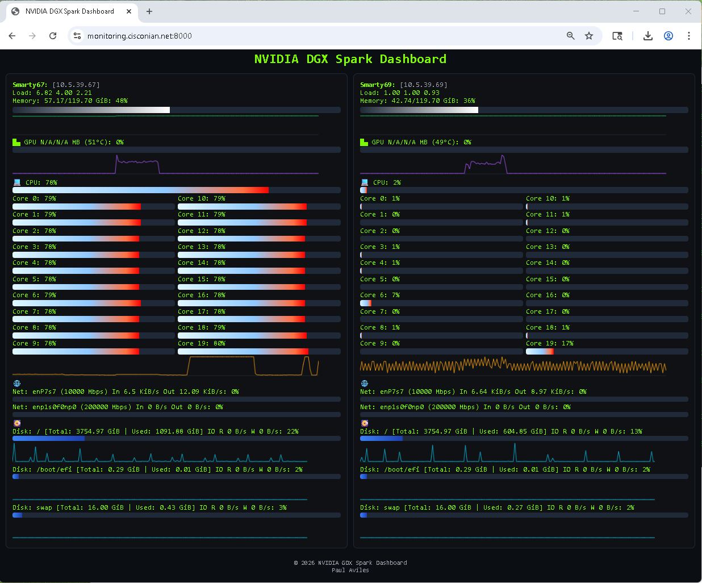
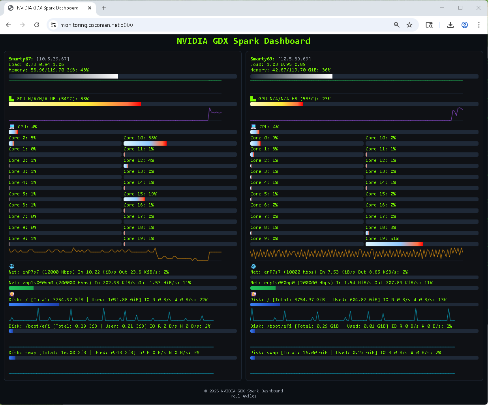

# NVIDIA GDX Spark Cluster Dashboard

This is a lightweight, real-time, browser-based monitoring dashboard
for **two** NVIDIA GDX Spark nodes. Inspired by **btop/htop** and
accessible from any browser. It is not for a single unit, if so,
use btop instead.

It does not run directly on the GDX Sparks, instead run in another
host monitoring two sparks over passwordless SSH connection.

It streams live metrics over WebSockets, pulls data via SSH from each
node, and renders CPU, memory, GPU, disk, and network stats with
sparklines and usage bars.

License: CC-BY-NC-ND-4.0

------------------------------------------------------------------------

## ✨ Features

-   📡 Multi-node monitoring over SSH (no agents required)
-   ⚡ Real-time updates via WebSockets (default: 1s refresh)
-   🧠 CPU: per-core usage + overall average + sparkline history
-   🧮 Memory: usage bar + historical sparkline
-   🎮 GPU: utilization, VRAM used/total, temperature (via `nvidia-smi`)
-   💽 Disks: capacity + live I/O (read/write rates) + sparkline
-   🌐 Network: per-interface throughput with autoscaled units
-   🔐 Key-based SSH only (no passwords stored)

------------------------------------------------------------------------

## 🏗️ Architecture Overview

    +-------------------+        WebSocket       +------------------------+
    |   Web Browser     | <--------------------> |  FastAPI Backend       |
    |  (index.html,     |                        |  server.py             |
    |   main.js, css)   |                        |                        |
    +-------------------+                        |  - AsyncSSH            |
                                                 |  - YAML config         |
                                                 |  - Metric collector    |
                                                 +-----------+------------+
                                                             |
                                                             | SSH (keys)
                                                             v
                                                  +-----------------------+
                                                  |  2 GDX Spark Nodes    |
                                                  |  /proc, nvidia-smi,   |
                                                  |  sysfs, df, ip, etc.  |
                                                  +-----------------------+

### Backend (FastAPI)

The simple backend does four main things:

1.  Loads `config.yaml` to discover cluster nodes.
2.  Opens SSH connections to each node using `asyncssh`.
3.  Runs a single batched shell command per node that collects:
    -   Load averages
    -   Memory usage
    -   CPU core stats (`/proc/stat`)
    -   GPU stats (`nvidia-smi`)
    -   Disk usage (`df`)
    -   Disk I/O (`/proc/diskstats`)
    -   Network counters (`/sys/class/net/*/statistics`)
    -   IP address of `enP7s7`
	-   IP address `enp1s0f0np0, enp1s0f1np1` (Hidden if not used)
4.  Streams JSON payloads to the browser over a WebSocket (`/ws`) every
    second.

Runs **one batched** command per refresh to minimize SSH overhead and latency.

### Frontend (Vanilla JS)

The frontend (index.html, style.css, main.js) has no build steps. Instead a
single main.js for simplicity served by FastAPI:

-   Opens a WebSocket to `/ws`
-   Receives an array of node objects every second
-   For each node:
    -   Renders usage bars (CPU, memory, GPU, disks, network)
    -   Maintains history buffers (up to 180 samples) for sparklines
    -   Draws sparklines on `<canvas>`
-   Automatically lays out nodes in two columns

------------------------------------------------------------------------

## 🔁 Data Flow

1.  Backend connects to `ws://host:8000/ws`
2.  Backend loop:
    -   For each node:
        -   Connect over SSH
        -   Run batched collector command
        -   Parse sections: LOAD, MEM, CPU, GPU, DISK, NET, DISKIO
        -   Compute deltas for CPU, network, and disk I/O
    -   Send JSON payload to browser
3.  Frontend updates bars and sparklines

------------------------------------------------------------------------

## 🚀 Performance Characteristics

-   1 SSH round-trip per node per second (batched)
-   Low backend CPU usage (text parsing + simple math)
-   Small network footprint (aggregated metrics only)
-   Lightweight canvas rendering in the browser

Scales well in my testing so far potentially extending to more nodes, primarily
limited by SSH latency and network conditions.

------------------------------------------------------------------------

## 📦 Requirements

-   fastapi
-   uvicorn
-   asyncssh
-   pyyaml
-   websockets

There are minimal installation requirements. Perform the following steps
on the monitoring hosts:

``` 
python3 -m venv .venv
source .venv/bin/activate
pip install -r backend/requirements.txt
```

------------------------------------------------------------------------

## 🔐 SSH Setup

### 1. Generate SSH keys on Monitoring host

On the monitoring host generate your public/private key pair.
Example below for user 'sysadmin'.

```
ssh-keygen -t rsa -f ~/.ssh/id_rsa_gdx_dashboard
```

```
Generating public/private rsa key pair.
Enter passphrase (empty for no passphrase):
Enter same passphrase again:
Your identification has been saved in /home/sysadmin/.ssh/id_rsa_gdx_dashboard
Your public key has been saved in /home/sysadmin/.ssh/id_rsa_gdx_dashboard.pub
The key fingerprint is:
SHA256:blablabla/g sysadmin@monitoring.cisconian.net
The key's randomart image is:
+---[RSA 3072]---+
|       ||       |
|    || || ||    |
| || || || || || |
| || || || || || |
|    || || ||    |
|       ||       |
+-----[SHA256]----+
```
### 2. Copy key to each node

```
ssh-copy-id -i ~/.ssh/id_rsa_gdx_dashboard.pub sysadmin@<IP of GDX Spark node>
```

```
INFO: Source of key(s) to be installed: "/home/sysadmin/.ssh/id_rsa_gdx_dashboard.pub"
INFO: attempting to log in with the new key(s), to filter out any that are already installed
INFO: 1 key(s) remain to be installed -- if you are prompted now it is to install the new keys

Number of key(s) added: 1
```

Now try logging into the machine, with:   "ssh 'sysadmin@<IP of GDX Spark node>'"
and check to make sure that only the key(s) you wanted were added.

### 3. Test SSH passwordless connection

Let's make sure the SSH passwordless connection is working first!. From
the monitoring host run:

```
ssh -i ~/.ssh/id_rsa_gdx_dashboard sysadmin@<IP of GDX Spark node>

Welcome to NVIDIA DGX Spark Version 7.4.0 (GNU/Linux 6.14.0-1015-nvidia aarch64)

 System information as of Sat Feb  7 12:15:59 PM EST 2026

  System load:  0.23              Temperature:             50.0 C
  Usage of /:   29.1% of 3.67TB   Processes:               513
  Memory usage: 46%               Users logged in:         0
  Swap usage:   2%                IPv4 address for enP7s7: 10.5.39.67
Last login: Sat Feb  7 12:14:15 2026 from monitoring.cisconian.net
```

It is working, so lets exit to go back.
```
exit
```

### 4. Create `backend/config.yaml`

Create the configuration for each of the two nodes. Change the username, IP address
and ssh key name accordingly.

``` yaml
nodes:
  - name: Smarty67
    host: 10.5.39.67
    port: 22
    username: sysadmin
    key_path: /home/sysadmin/.ssh/id_rsa_gdx_dashboard

  - name: Smarty69
    host: 10.5.39.69
    port: 22
    username: sysadmin
    key_path: /home/sysadmin/.ssh/id_rsa_gdx_dashboard
```

------------------------------------------------------------------------

## ▶️ Running

Server runs on port 8000, but it can be changed. After activating the 
environment with: 
```
source .venv/bin/activate
```

``` bash
uvicorn server:app --host 0.0.0.0 --port 8000
INFO:     Started server process [646972]
INFO:     Waiting for application startup.
INFO:     Application startup complete.
INFO:     Uvicorn running on http://0.0.0.0:8000 (Press CTRL+C to quit)
INFO:     10.5.37.24:62432 - "GET / HTTP/1.1" 200 OK
INFO:     10.5.37.24:62432 - "GET /favicon.ico HTTP/1.1" 200 OK
INFO:     10.5.37.24:58063 - "WebSocket /ws" [accepted]
INFO:     connection open
INFO:     10.5.37.24:57319 - "GET /ws HTTP/1.1" 200 OK
INFO:     connection closed
INFO:     10.5.37.24:57319 - "GET /favicon.ico HTTP/1.1" 200 OK
WebSocket client disconnected
INFO:     10.5.37.24:57319 - "GET /favicon.ico HTTP/1.1" 200 OK
INFO:     10.5.37.24:57857 - "WebSocket /ws" [accepted]
INFO:     connection open
```

Open your browser and navigate to:

    http://<server-ip>:8000

------------------------------------------------------------------------

## 🖼️ Screenshots

> Real-time view of multiple NVIDIA GDX Spark nodes, showing CPU,
> memory, GPU, disk, and network activity with historical sparklines.




------------------------------------------------------------------------

## 🛣️ Roadmap

There are several improvements that can be done including code cleanup and 
scaling over two nodes primarily. 

-   More than 2 nodes on the same dashboard
-   Multi-GPU support per node
-   Per-process GPU usage (via `nvidia-smi pmon` or compute apps query)
-   Threshold-based alerts (temp, memory, disk, CPU)
-   Configurable refresh interval
-   Historical time ranges (5 min, 1 hour, 24 hours)
-   Optional metrics persistence (SQLite)
-   Pluggable collectors (enable/disable modules)
-   Collapsible sections
-   Cluster-wide aggregate views
-   Authentication and access control
-   Integration with SIEM (Splunk, ELK, Graylog)

------------------------------------------------------------------------

## 📜 License

CC-BY-NC-ND-4.0\
Creative Commons Attribution-NonCommercial-NoDerivatives 4.0 International

